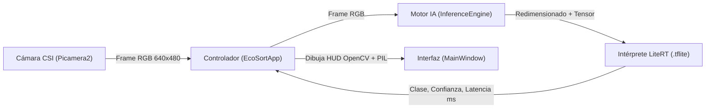

# ♻️ EcoSort AI — Banco de Pruebas Edge AI (`PruebaModelos`)


-A22846?logo=raspberrypi&logoColor=white)
-FF6F00?logo=tensorflow&logoColor=white)


**EcoSort AI (`PruebaModelos`)** es una aplicación de visión artificial en el borde (*Edge AI*) diseñada para ejecutarse de forma nativa en **Raspberry Pi 5**. Su propósito principal es clasificar residuos sólidos en tiempo real y servir como entorno de evaluación comparativa (*benchmarking*) entre distintas arquitecturas de redes neuronales ligeras exportadas a **LiteRT / TensorFlow Lite (`.tflite`)**.

---

## ✨ Características Principales

* **Intercambio de Modelos en Caliente (*Hot-Swap*):** Permite alternar entre 6 arquitecturas de redes neuronales directamente desde la interfaz gráfica sin necesidad de reiniciar la aplicación ni detener el flujo de cámara.
* **Captura Nativa de Baja Latencia (`Picamera2`):** Integración directa con el stack `libcamera` de Raspberry Pi OS (Bookworm), capturando fotogramas en memoria RAM a `640x480` con corrección automática de espacio de color RGB.
* **Adaptación Dinámica de Tensores:** El motor de inferencia inspecciona automáticamente el modelo cargado para ajustar la resolución de entrada y detectar si requiere formato **Channel-Last (`NHWC`)** (típico en Keras/TensorFlow) o **Channel-First (`NCHW`)** (típico en PyTorch/YOLO).
* **Telemetría y HUD en Tiempo Real:** Superposición en video (*Heads-Up Display*) con cálculo de **FPS suavizados** (filtro exponencial), nombre de la red activa, resolución de captura y medición precisa de **latencia de inferencia en milisegundos (`ms`)**.
* **Interfaz Optimizada para Pantallas Embebidas:** Construida con `CustomTkinter` en resolución `1024x600` (modo oscuro) con retroalimentación visual por código de colores según el material clasificado.
* **Registro de Eventos (*Logging*):** Sistema de bitácora dual (consola y archivo rotativo en `logs/ecosort_app.log`) bajo el identificador `RENOVA`.

---

## 🧠 Modelos Incluidos y Categorías de Clasificación

### Categorías Soportadas
El sistema clasifica los objetos capturados en **5 clases**, aplicando un umbral de confianza configurable (`85%` por defecto; si es menor, el estado se muestra como `ANALIZANDO...`):

| Clase | Descripción | Indicador Visual (UI) |
| :--- | :--- | :--- |
| **`aluminio`** | Latas de bebidas, envases metálicos ligeros | Gris Plata (`#A9A9A9`) |
| **`carton`** | Cajas, empaques de papel y cartón corrugado | Café Claro (`#D2B48C`) |
| **`plastico`** | Botellas PET, envases de polietileno/polipropileno | Azul Brillante (`#1E90FF`) |
| **`vidrio`** | Botellas y frascos de vidrio | Verde Agua (`#20B2AA`) |
| **`otros`** | Residuos generales o no pertenecientes a las clases anteriores | Blanco (`#FFFFFF`) |

### Arquitecturas en `Models/`
| Nombre en UI | Archivo del Modelo (`.tflite`) | Formato de Entrada |
| :--- | :--- | :--- |
| **MobileNetV3 (Recomendado)** | `Models/MobileNetV3/modelo_residuos_rpi_V3_05.tflite` | `NHWC` (Channel-Last) |
| **EfficientNetB0** | `Models/EfficientNetB0/modelo_residuos_EfficientNetB0_v1.tflite` | `NHWC` (Channel-Last) |
| **MobileNetV2** | `Models/MobileNetV2/modelo_residuos_rpi_03.tflite` | `NHWC` (Channel-Last) |
| **ShuffleNetV2** | `Models/ShuffleNetV2/modelo_residuos_shufflenetV2_imagenet.tflite` | Dinámico (`NHWC`/`NCHW`) |
| **SqueezeNet** | `Models/SqueezeNet/modelo_residuos_SqueezeNet_imagenet.tflite` | Dinámico (`NHWC`/`NCHW`) |
| **YOLO v1** | `Models/YOLO/modelo_residuos_YOLO_v1.tflite` | `NCHW` (Channel-First) |

---

## 🏗️ Arquitectura del Proyecto

```text
PruebaModelos/
├── config.py                 # Configuración global: rutas, modelos, clases, umbral y logging
├── main.py                   # Punto de entrada y controlador principal (EcoSortApp)
├── run.sh                    # Script de reparación de dependencias gráficas (Tkinter/Pillow)
├── core/
│   ├── __init__.py
│   ├── camera.py             # Gestión de cámara CSI nativa mediante Picamera2 / libcamera
│   └── inference.py          # Motor de inferencia LiteRT (carga, preprocesamiento y predicción)
├── ui/
│   ├── __init__.py
│   └── main_window.py        # Interfaz gráfica de usuario en CustomTkinter (MainWindow)
├── Models/                   # Repositorio local de modelos .tflite organizados por arquitectura
│   ├── EfficientNetB0/
│   ├── MobileNetV2/
│   ├── MobileNetV3/
│   ├── ShuffleNetV2/
│   ├── SqueezeNet/
│   └── YOLO/
├── test/
│   └── camara_prueba.py      # Utilidad de diagnóstico para escanear puertos de video con OpenCV
└── logs/                     # Generado automáticamente en ejecución (ecosort_app.log)
```

### Flujo de Procesamiento


---

## 🔧 Requisitos del Sistema

### Hardware
* **Placa:** Raspberry Pi 5 (compatible con Raspberry Pi 4 con Raspberry Pi OS Bookworm).
* **Cámara:** Módulo de cámara oficial Raspberry Pi conectado por puerto **CSI** (gestionado por `libcamera`).
* **Pantalla:** Monitor o pantalla táctil (interfaz optimizada para `1024x600` píxeles o superior).

### Software y Dependencias
* **Sistema Operativo:** Raspberry Pi OS (Debian 12 *Bookworm* de 64 bits recomendado).
* **Paquetes del Sistema:**
  * `python3-picamera2` (instalado en el sistema base)
  * `python3-tk` y `python3-pil.imagetk`
* **Paquetes de Python:**
  * `ai-edge-litert` (intérprete ligero de Google para modelos `.tflite`)
  * `customtkinter`
  * `opencv-python` (`cv2`)
  * `numpy`
  * `Pillow` (`PIL`)

---

## 🚀 Instalación y Configuración

### 1. Clonar el repositorio
```bash
git clone https://github.com/LordAguaKate/PruebaModelos.git
cd PruebaModelos
```

### 2. Instalar dependencias gráficas del sistema operativo
En Raspberry Pi OS, `Picamera2` depende de librerías del sistema (`libcamera`), por lo que se recomienda crear el entorno virtual con acceso a los paquetes del sistema (`--system-site-packages`):

```bash
sudo apt-get update
sudo apt-get install -y python3-picamera2 python3-tk python3-pil.imagetk
```

### 3. Crear y activar el entorno virtual
```bash
python3 -m venv --system-site-packages .venv
source .venv/bin/activate
```

### 4. Instalar dependencias de Python
```bash
pip install --upgrade pip
pip install ai-edge-litert customtkinter opencv-python numpy
pip install --ignore-installed Pillow
```

> **Nota:** Si experimentas problemas con `ImageTk` al renderizar el video en `CustomTkinter` dentro del entorno virtual, ejecuta el script de reparación incluido:
> ```bash
> chmod +x run.sh
> ./run.sh
> ```

---

## ▶️ Uso de la Aplicación

Con el entorno virtual activo, inicia la aplicación ejecutando:

```bash
python main.py
```

1. **Seleccionar Arquitectura:** En el panel izquierdo, despliega el menú **"Arquitectura de Red Neuronal"** y elige el modelo `.tflite` que deseas evaluar (por defecto se carga `MobileNetV3`).
2. **Iniciar Captura:** Presiona el botón **"INICIAR CÁMARA"**. Se activará el flujo de video CSI con el HUD superpuesto mostrando los FPS reales, el modelo en uso y la resolución.
3. **Evaluar Predicciones:** Coloca el residuo frente a la cámara. El panel inferior mostrará la clase detectada con su color distintivo y el porcentaje de confianza cuando supere el umbral configurado (`85%`), mientras que en la esquina inferior izquierda podrás monitorear la **latencia de inferencia en milisegundos**.
4. **Cambiar Modelo en Vivo:** Puedes seleccionar cualquier otro modelo en el menú desplegable mientras la cámara sigue encendida para comparar inmediatamente la diferencia en FPS, latencia y estabilidad de predicción.

---

## ⚙️ Personalización (`config.py`)

Puedes ajustar el comportamiento global del sistema editando el archivo `config.py`:

* **`CONFIDENCE_THRESHOLD`**: Umbral mínimo de probabilidad (`0.0` a `1.0`) para aceptar una clasificación (por defecto `0.85`).
* **`AVAILABLE_MODELS`**: Diccionario que enlaza el nombre mostrado en la interfaz con la ruta del archivo `.tflite`. Para agregar un nuevo modelo, basta con colocar el archivo en `Models/` y añadir su entrada aquí.
* **`CLASSES`**: Lista ordenada de etiquetas de salida del modelo (`["aluminio", "carton", "otros", "plastico", "vidrio"]`).
* **`UI_THEME` / `WINDOW_SIZE`**: Apariencia (`"Dark"`, `"Light"`, `"System"`) y dimensiones de la ventana principal (`"1024x600"`).

---

## 🛠️ Diagnóstico y Solución de Problemas

* **Error `No se encontró Picamera2`:** Asegúrate de haber creado el entorno virtual con la bandera `--system-site-packages`, ya que `python3-picamera2` se distribuye a través de los repositorios `apt` de Raspberry Pi OS.
* **Colores invertidos ("Efecto Pitufo"):** La clase `Camera` en `core/camera.py` detecta automáticamente si `libcamera` aplica un formato *little-endian* (`RGB888` o `XRGB8888`) e invierte los canales Rojo/Azul según sea necesario. Puedes verificar el formato aplicado revisando el archivo `logs/ecosort_app.log`.
* **Prueba de cámaras V4L2 / USB:** Si deseas verificar qué índices de video detecta OpenCV en el sistema, ejecuta el script de diagnóstico:
  ```bash
  python test/camara_prueba.py
  ```

---

## 📄 Licencia

Este proyecto está bajo la **Licencia MIT**. Consulta el archivo [LICENSE](LICENSE) para más detalles.

---
**Autor:** Jesús Rivera ([@LordAguaKate](https://github.com/LordAguaKate)) — *Proyecto EcoSort Edge AI*
