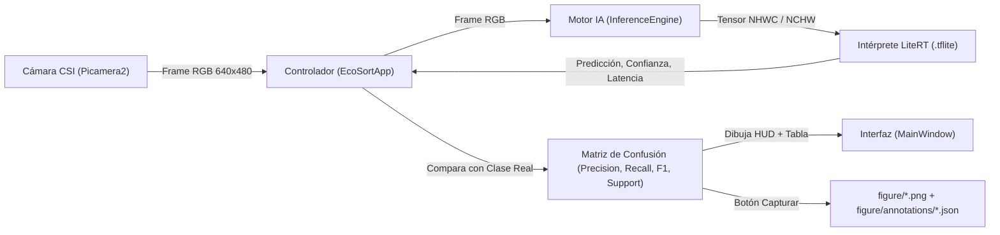

# ♻️ EcoSort AI — Banco de Pruebas y Evaluación Edge AI (`PruebaModelos`)


-A22846?logo=raspberrypi&logoColor=white)
-FF6F00?logo=tensorflow&logoColor=white)


**EcoSort AI (`PruebaModelos`)** es una plataforma de visión artificial en el borde (*Edge AI*) diseñada para ejecutarse de forma nativa en **Raspberry Pi 5**. Su propósito es clasificar residuos sólidos en tiempo real, evaluar interactivamente el desempeño de modelos en vivo (con métricas de `precision`, `recall`, `f1-score` y `support`) y servir como suite de evaluación comparativa (*benchmarking*) entre arquitecturas de redes neuronales ligeras exportadas a **LiteRT / TensorFlow Lite (`.tflite`)**.

---

## ✨ Características Principales

* **Intercambio de Modelos en Caliente (*Hot-Swap*):** Permite alternar entre 6 arquitecturas de redes neuronales directamente desde la interfaz gráfica sin reiniciar la aplicación ni detener el flujo de cámara.
* **Evaluación en Tiempo Real (`Precision`, `Recall`, `F1-Score`, `Support`):**
  * Selector de **Clase Real (*Ground Truth*)** en la interfaz para contrastar el objeto físico frente a la cámara con la predicción de la red neuronal.
  * Matriz de confusión independiente por modelo en memoria, con interruptor **Evaluar en Tiempo Real** (acumulación fotograma a fotograma o evaluación puntual foto por foto) y botón de **Reinicio de Métricas**.
  * Tabla estilo `classification_report` (`scikit-learn`) superpuesta en vivo sobre el video con métricas por clase, `accuracy`, `macro avg` y `weighted avg`.
* **Captura de Evidencia (`figure/`) y Anotaciones JSON (`figure/annotations/`):**
  * Botón **"CAPTURAR IMAGEN"** que guarda instantáneamente el fotograma `.png` con el HUD de telemetría y la tabla completa de métricas en `figure/`.
  * Genera automáticamente un archivo `.json` emparejado en `figure/annotations/` con marca de tiempo, resolución, FPS, latencia, configuración del tensor, predicción, métricas por clase y matriz de confusión completa.
* **Captura Nativa de Baja Latencia (`Picamera2`):** Integración directa con el stack `libcamera` de Raspberry Pi OS, capturando fotogramas en memoria RAM a `640x480` con corrección automática de espacio de color RGB.
* **Adaptación Dinámica de Tensores:** El motor de inferencia inspecciona automáticamente el modelo cargado para ajustar la resolución de entrada y detectar si requiere formato **Channel-Last (`NHWC`)** (Keras/TensorFlow) o **Channel-First (`NCHW`)** (PyTorch/Ultralytics YOLO).
* **Suite Completa de Benchmarking Reproducible (`pruebas_modelos/`):** Incluye scripts de pruebas masivas en Raspberry Pi y computadora local, generación automatizada de 14 gráficas científicas, maquetación de reportes PDF y los resultados oficiales sobre 4,534 imágenes de prueba.

---

## 🧠 Modelos Incluidos y Categorías de Clasificación

### Categorías Soportadas
El sistema clasifica los objetos capturados en **5 clases**, aplicando un umbral de confianza configurable (`85%` por defecto para la etiqueta principal de estado):

| Clase | Descripción | Indicador Visual (UI) |
| :--- | :--- | :--- |
| **`aluminio`** | Latas de bebidas, envases metálicos ligeros | Gris Plata (`#A9A9A9`) |
| **`carton`** | Cajas, empaques de papel y cartón corrugado | Café Claro (`#D2B48C`) |
| **`plastico`** | Botellas PET, envases de polietileno/polipropileno | Azul Brillante (`#1E90FF`) |
| **`vidrio`** | Botellas y frascos de vidrio | Verde Agua (`#20B2AA`) |
| **`otros`** | Residuos generales o no pertenecientes a las clases anteriores | Blanco (`#FFFFFF`) |

### Arquitecturas en `Models/` (Aplicación Interactiva)
| Nombre en UI | Archivo del Modelo (`.tflite`) | Tamaño | Formato de Entrada |
| :--- | :--- | :--- | :--- |
| **MobileNetV3 (Recomendado)** | `Models/MobileNetV3/modelo_residuos_rpi_V3_05.tflite` | 3.24 MB | `[1, 224, 224, 3]` (`NHWC`) |
| **EfficientNetB0** | `Models/EfficientNetB0/modelo_residuos_EfficientNetB0_v1.tflite` | 4.50 MB | `[1, 224, 224, 3]` (`NHWC`) |
| **MobileNetV2** | `Models/MobileNetV2/modelo_residuos_rpi_03.tflite` | 2.55 MB | `[1, 224, 224, 3]` (`NHWC`) |
| **ShuffleNetV2** | `Models/ShuffleNetV2/modelo_residuos_shufflenetV2_imagenet.tflite` | 1.50 MB | `[1, 224, 224, 3]` (`NHWC`) |
| **SqueezeNet** | `Models/SqueezeNet/modelo_residuos_SqueezeNet_imagenet.tflite` | 0.81 MB | `[1, 224, 224, 3]` (`NHWC`) |
| **YOLO v1** | `Models/YOLO/modelo_residuos_YOLO_v1.tflite` | 5.39 MB | `[1, 3, 224, 224]` (`NCHW`) |

---

## 🏗️ Arquitectura del Proyecto

```text
PruebaModelos/
├── config.py                      # Configuración global: rutas, modelos, clases, umbral y logging
├── main.py                        # Controlador principal, cálculo de métricas, HUD y exportación PNG/JSON
├── run.sh                         # Script de reparación de dependencias gráficas (Tkinter/Pillow)
├── core/
│   ├── __init__.py
│   ├── camera.py                  # Gestión de cámara CSI nativa mediante Picamera2 / libcamera
│   └── inference.py               # Motor de inferencia LiteRT (carga dinámica NHWC/NCHW y predicción)
├── ui/
│   ├── __init__.py
│   └── main_window.py             # Interfaz gráfica en CustomTkinter (controles, visor y barra de métricas)
├── Models/                        # Modelos .tflite utilizados por la aplicación en tiempo real
│   ├── EfficientNetB0/
│   ├── MobileNetV2/
│   ├── MobileNetV3/
│   ├── ShuffleNetV2/
│   ├── SqueezeNet/
│   └── YOLO/
├── figure/                        # Capturas .png generadas desde la interfaz con HUD y tabla de métricas
│   └── annotations/               # Archivos .json emparejados con cada captura (telemetría y evaluación)
├── pruebas_modelos/               # Suite de benchmarking científico, modelos originales y reportes técnicos
│   ├── README.md                  # Guía detallada para ejecutar los benchmarks y generar gráficas/PDFs
│   ├── raspberry/                 # Scripts de benchmark físico y visual en terminal para Raspberry Pi
│   ├── local/                     # Scripts de evaluación (.keras vs .tflite) en computadora
│   ├── reportes/                  # Generadores de gráficas (Matplotlib) y reportes PDF (WeasyPrint)
│   ├── modelos/                   # Copia de respaldo de los modelos .tflite, .keras y .pt
│   └── resultados/                # Reportes (.md/.pdf), datos crudos (.json), logs y 14 gráficas (.png)
├── test/
│   └── camara_prueba.py           # Utilidad de diagnóstico para escanear puertos de video con OpenCV
└── logs/                          # Generado automáticamente en ejecución (ecosort_app.log)
```

### Flujo de Procesamiento y Captura en Tiempo Real


---

## 🔧 Requisitos e Instalación (Aplicación Principal)

### Hardware
* **Placa:** Raspberry Pi 5 (compatible con Raspberry Pi 4 con Raspberry Pi OS Bookworm).
* **Cámara:** Módulo de cámara oficial Raspberry Pi conectado por puerto **CSI** (gestionado por `libcamera`).
* **Pantalla:** Monitor o pantalla táctil (interfaz optimizada para `1024x600` píxeles o superior).

### Instalación Paso a Paso

1. **Clonar el repositorio:**
   ```bash
   git clone https://github.com/LordAguaKate/PruebaModelos.git
   cd PruebaModelos
   ```

2. **Instalar dependencias del sistema operativo:**
   En Raspberry Pi OS, `Picamera2` se enlaza con `libcamera` a nivel del sistema, por lo que el entorno virtual debe crearse con `--system-site-packages`:
   ```bash
   sudo apt-get update
   sudo apt-get install -y python3-picamera2 python3-tk python3-pil.imagetk
   ```

3. **Crear y activar el entorno virtual:**
   ```bash
   python3 -m venv --system-site-packages .venv
   source .venv/bin/activate
   ```

4. **Instalar paquetes de Python:**
   ```bash
   pip install --upgrade pip
   pip install ai-edge-litert customtkinter opencv-python numpy
   pip install --ignore-installed Pillow
   ```

> **Nota:** Si experimentas problemas con `ImageTk` al renderizar el video en `CustomTkinter` dentro del entorno virtual, ejecuta el script de reparación incluido:
> ```bash
> chmod +x run.sh
> ./run.sh
> ```

---

## ▶️ Uso de la Aplicación Interactiva y Captura de Datos

Con el entorno virtual activo, inicia la aplicación ejecutando:

```bash
python main.py
```

1. **Seleccionar Arquitectura:** En el panel lateral izquierdo, elige el modelo `.tflite` en el menú **"Arquitectura de Red Neuronal"** (por defecto `MobileNetV3`).
2. **Seleccionar Clase Real (*Ground Truth*):** En el menú **"Clase Real (Objeto a evaluar)"**, selecciona el tipo de residuo físico que vas a colocar frente a la cámara (`aluminio`, `carton`, `otros`, `plastico` o `vidrio`).
3. **Configurar el Modo de Evaluación:**
   * **Switch `"Evaluar en Tiempo Real"` activado (por defecto):** Cada fotograma procesado se registra automáticamente en la matriz de confusión del modelo activo, actualizando `precision`, `recall`, `f1-score` y `support` en vivo tanto en la tabla del HUD del video como en la barra inferior. Puedes desactivarlo momentáneamente mientras retiras un objeto y colocas otro para no contaminar las métricas.
   * **Switch `"Evaluar en Tiempo Real"` desactivado (modo foto por foto):** Las métricas solo se actualizan cada vez que presionas **"CAPTURAR IMAGEN"**.
4. **Iniciar Cámara y Capturar Evidencia:**
   * Presiona **"INICIAR CÁMARA"** para abrir el flujo de video CSI.
   * Presiona **"CAPTURAR IMAGEN"** para guardar la evidencia del ensayo:
     * **Imagen PNG (`figure/`):** `figure/captura_<timestamp>_<Modelo>_real-<ClaseReal>_pred-<ClasePredicha>.png` con el HUD superior (`FPS`, `Latencia`, `Red`, `Res`, `Real vs Pred`) y la tabla inferior derecha (`PREC`, `REC`, `F1`, `SUP`, `accuracy`, `macro avg`, `weighted`).
     * **Anotación JSON (`figure/annotations/`):** `figure/annotations/captura_<timestamp>_<Modelo>_real-<ClaseReal>_pred-<ClasePredicha>.json` con todos los metadatos de rendimiento, configuración del modelo, métricas desglosadas por clase y la matriz de confusión $5 \times 5$.
5. **Reiniciar Métricas:** Presiona **"REINICIAR MÉTRICAS"** en cualquier momento para poner en cero la matriz de confusión del modelo activo e iniciar una nueva ronda de evaluación.

---

## 📊 Suite de Benchmarking y Reportes (`pruebas_modelos/`)

La carpeta [`pruebas_modelos/`](pruebas_modelos/) contiene el ecosistema completo para ejecutar pruebas masivas y reproducibles sobre el conjunto de prueba `waste_classification` (**4,534 imágenes** distribuidas en las 5 clases), así como los datos crudos, gráficas y reportes técnicos ya generados.

> Consulta la **[Guía completa en `pruebas_modelos/README.md`](pruebas_modelos/README.md)** para ver todos los comandos y parámetros detallados.

### Estructura de `pruebas_modelos/`

* **[`pruebas_modelos/raspberry/`](pruebas_modelos/raspberry/)** — **Scripts ejecutados en la Raspberry Pi:**
  * `benchmark_visual.py`: Benchmark comparativo interactivo en terminal (con `Rich`) que evalúa los **5 modelos `.tflite`** aplicando a cada arquitectura su preprocesamiento nativo de entrenamiento (`NHWC` `0–255` con estirado *nearest* para modelos Keras, y `NCHW` `0–1` con recorte central bilineal para `YOLO11s-cls`). Mide precisión, latencia por imagen, memoria RAM aislada y una prueba de estabilidad continua de 5 minutos por modelo monitoreando CPU por núcleo, temperatura del SoC, frecuencia y *throttling*. Exporta `resultados.json` y capturas de terminal en `.svg`.
  * `Benchmark_rpi.py`: Benchmark individual de latencia y estabilidad en consola para un solo archivo `.tflite`.
  * `test_camara_realtime.py`: Script independiente con OpenCV para prueba de cámara con `MobileNetV2`.
* **[`pruebas_modelos/local/`](pruebas_modelos/local/)** — **Scripts de evaluación en computadora:**
  * `comparar_modelos_inferencia.py`: Evalúa los modelos originales `.keras` sobre las 4,534 imágenes y genera tablas comparativas de Accuracy, Loss, F1, tamaño y matrices de confusión.
  * `Evaluate_tflite.py`: Compara el modelo `.tflite` cuantizado frente al `.keras` original para medir la variación de precisión tras la cuantización.
  * `comparar_modelos.py`: Extrae tablas comparativas directamente de los notebooks `.ipynb` de evaluación.
* **[`pruebas_modelos/reportes/`](pruebas_modelos/reportes/)** — **Generación de gráficas y documentos PDF:**
  * `graficar_benchmark_rpi.py`: Procesa los `resultados.json` (1 hilo y 4 hilos) y genera **14 gráficas científicas en PNG** (`Matplotlib`) con paleta apta para daltonismo e intervalos de confianza de Wilson al 95%, además de convertir las capturas `.svg` de terminal a `.png`.
  * `generar_pdf_reporte.py`: Convierte los reportes Markdown en documentos PDF maquetados (`WeasyPrint`) con portada ejecutiva, tarjetas de resumen, índice paginado y figuras numeradas.
* **[`pruebas_modelos/modelos/`](pruebas_modelos/modelos/)** — **Respaldo de modelos originales y cuantizados:**
  * Contiene tanto los archivos desplegables (`.tflite`) como los modelos base previos a la cuantización (`.keras` y `.pt`).
* **[`pruebas_modelos/resultados/`](pruebas_modelos/resultados/)** — **Resultados oficiales, reportes y gráficas:**
  * `resultados/docs/`: Reportes completos en `.md` y `.pdf` del benchmark de 5 modelos en Raspberry Pi 5, comparativas de 3 modelos (Laptop + Raspberry Pi 5) y pruebas en Raspberry Pi 4.
  * `resultados/reports/`: Archivos JSON crudos (`1hilo` y `4hilos`), bitácoras de ejecución, capturas SVG y las carpetas `figures/` con todas las gráficas PNG.

### Resumen de Resultados Oficiales en Raspberry Pi 5 (4,534 imágenes, 1 hilo)

| Modelo (`.tflite`) | Accuracy | Errores | F1 Macro | Latencia Media | FPS (`Cuadros/s`) | Peor Caso (H1 < 200 ms) | RAM del Modelo | Tamaño `.tflite` |
| :--- | :---: | :---: | :---: | :---: | :---: | :---: | :---: | :---: |
| **MobileNetV3-Large** | 96.47% | 160 / 4,534 | 0.9627 | 15.54 ms | 64.3 | 18.29 ms | 17.1 MB | 3.24 MB |
| **EfficientNetB0** | 96.67% | 151 / 4,534 | 0.9648 | 45.46 ms | 22.0 | 49.40 ms | 34.2 MB | 4.50 MB |
| **ShuffleNetV2 (ImageNet)** | 94.18% | 264 / 4,534 | 0.9381 | **9.49 ms** | **105.3** | **11.60 ms** | 12.2 MB | 1.50 MB |
| **SqueezeNet v1.1 (ImageNet)** | 91.75% | 374 / 4,534 | 0.9111 | 9.95 ms | 100.5 | 13.46 ms | **10.9 MB** | **0.81 MB** |
| **YOLO11s-cls** | **97.44%** | **116 / 4,534** | **0.9728** | 23.78 ms | 42.0 | 26.39 ms | 21.7 MB | 5.39 MB |

---

## ⚙️ Personalización (`config.py`)

Puedes ajustar el comportamiento global de la aplicación principal editando el archivo [`config.py`](config.py):

* **`CONFIDENCE_THRESHOLD`**: Umbral mínimo de probabilidad (`0.0` a `1.0`) para mostrar la clase confirmada en la etiqueta principal (por defecto `0.85`).
* **`AVAILABLE_MODELS`**: Diccionario que enlaza el nombre mostrado en la interfaz con la ruta del archivo `.tflite` en `Models/`.
* **`CLASSES`**: Lista ordenada de etiquetas de salida del modelo (`["aluminio", "carton", "otros", "plastico", "vidrio"]`).
* **`FIGURE_DIR` / `ANNOTATIONS_DIR`**: Rutas donde se almacenan las capturas `.png` (`figure/`) y sus archivos `.json` (`figure/annotations/`).
* **`UI_THEME` / `WINDOW_SIZE`**: Apariencia (`"Dark"`, `"Light"`, `"System"`) y dimensiones de la ventana principal (`"1024x600"`).

---

## 🛠️ Diagnóstico y Solución de Problemas

* **Error `No se encontró Picamera2`:** Asegúrate de haber creado el entorno virtual con la bandera `--system-site-packages`, ya que `python3-picamera2` se distribuye a través de los repositorios `apt` de Raspberry Pi OS.
* **Colores invertidos ("Efecto Pitufo"):** La clase `Camera` en `core/camera.py` detecta automáticamente si `libcamera` aplica un formato *little-endian* (`RGB888` o `XRGB8888`) e invierte los canales Rojo/Azul según sea necesario. Puedes verificar el formato aplicado revisando el archivo `logs/ecosort_app.log`.
* **Prueba de cámaras V4L2 / USB:** Si deseas verificar qué índices de video detecta OpenCV en el sistema, ejecuta el script de diagnóstico:
  ```bash
  python test/camara_prueba.py
  ```

---

## 📄 Licencia

Este proyecto está bajo la **Licencia MIT**. Consulta el archivo [LICENSE](LICENSE) para más detalles.

---
**Autor:** Jesús Rivera ([@LordAguaKate](https://github.com/LordAguaKate)) — *Proyecto EcoSort Edge AI*
